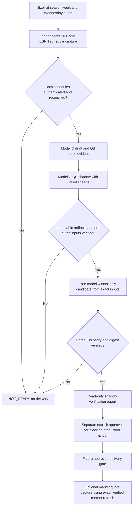

# Wednesday cross-workflow dependency map and acceptance gates

**DESIGN ONLY.** This file is a proposed contract, not a production gate or a guarantee that existing workflows meet it. PR #7 must remain draft. Depends conceptually on PR #6 research-only evidence tests; no code from PR #6 is included.

## Actual current execution paths (main, reviewed November 8, 2026)

| Path | Current trigger | Reads | Writes / side effects | Missing dependency |
|---|---|---|---|---|
| `.github/workflows/model-c-draft.yml` | Wed 15:05 and 16:05 UTC cron; push and manual dispatch can also run | official news/injury/depth-chart inputs, history, schedule-dependent drafts | generates Model C, C-QB, refresh, market research; commits files | no authenticated current-week schedule + immutable same-run provenance barrier before refresh |
| `scripts/model_c_engine.py` | step in Model C workflow | Model C evidence | `data/model-c-automated-draft.json` | needs exact week, schedule and cutoff proof |
| `scripts/model_c_qb_shadow.py` | subsequent step | Model C draft and QB evidence | `data/model-c-qb-shadow.json` | needs linked source run, verified QB source freshness and parity |
| `scripts/nfl_market_totals_feed.py` | Model C workflow, before refresh | lexically latest `*-refresh-*.json` | `data/nfl-market-totals.json` | may consume stale refresh; cannot be evidence for current run |
| `scripts/nfl_four_model_refresh.py` | Model C workflow, after market feed | mutable Model C/C-QB/history files | timestamped research-only four-model refresh | needs immutable verified schedule and exact same-run inputs |
| `.github/workflows/nfl-four-model-head-to-head.yml` | Wed 15:15/16:15 UTC, Tue 09:30 UTC, manual | mutable Model C/C-QB/history | freeze or grade `data/four-model-head-to-head/{season}-week-{week}.json`, commit/push | no dependency on Model C workflow success or same-week artifacts |
| `scripts/nfl_four_model_head_to_head.py` | freeze/grade step | mutable draft/shadow/history, existing card | may grade existing archive or create new card | existing card is not proof of current Wednesday freeze |

The UTC cron pairs attempt DST coverage; **cron ordering is not a dependency**. The 10-minute offset between Model C and four-model workflows does not guarantee completion. Push/manual triggers can run outside the nominal Wednesday window; a design gate must explicitly enforce requested Wednesday cutoff independently of the trigger.

## Proposed dependency DAG (future implementation only)

The **read-only shadow report stops at I**. Nodes J–L are future proposals, not operations authorized by this PR. Market quote capture can be independently sourced earlier, but any *join to a prediction card* must happen after the verified current-week card exists; no lexical latest-file fallback.

## Acceptance criteria for future real verifier

**A1 — Requested slate:** caller supplies season, week, Wednesday local cutoff, canonical game ID list, and expected schedule source IDs. Count is `len(canonical_game_ids)` and must be positive; never hard-code 15. Reject duplicate IDs, empty slate, different IDs, teams or kickoff times.

**A2 — Independent schedule:** capture raw NFL and ESPN source responses, source URLs, retrieval timestamps and SHA-256; normalize to the same canonical IDs and UTC kickoffs. Reject disagreement or unverified identity. Do not infer independent confirmation from two files originating from the same ESPN feed.

**A3 — Immutable GitHub artifacts:** use exact GitHub workflow run ID, artifact ID, workflow identity, commit SHA and authenticated repository. Retrieve the actual artifact bytes; compute SHA-256 of the specified payload member, verify archive member path, and match against manifest. Check run completion/success and source commit through GitHub API. A supplied manifest is a claim, not authentication. Reject mutable branches, latest-file globs, missing artifacts, invalid hashes and wrong workflow lineage.

**A4 — Cross-workflow barrier:** Model C and C-QB must belong to same requested slate, with source run or explicit linked run identities. Four-model candidate must record the exact hashes of both inputs and A/B baseline. The consumer cannot start delivery until producer run has completed successfully and all artifacts have been independently verified; an elapsed 10-minute cron delay is insufficient.

**A5 — Wednesday cutoff:** derive cutoff using `America/New_York` timezone and the correct DST offset. All prediction-affecting inputs must be available at or before the explicitly declared cutoff; generation, retrieval, and publication timestamps are distinct. Reject post-cutoff inputs from Wednesday 11 AM claims even when before first kickoff. A later refresh must have separate status and provenance. Reject any candidate generated after its first game kickoff.

**A6 — Missing-data fail closed:** unavailable schedule, QB1 evidence, Model C, C-QB, A/B history, artifact retrieval, or market quote must be recorded with a reason code. Mandatory model/schedule evidence => `NOT_READY` and nonzero gate exit; never silently reuse prior week. Market quotes are optional only for winner-only research; when unavailable mark `NO_SOURCED_MARKET_LINES` and produce no market pick, not invented lines. Do not confuse unverified QB1 with a confirmed starter.

**A7 — Market ordering:** forbid `sorted(glob('*-refresh-*.json'))[-1]` as source selection. Any market-to-card comparison must bind explicitly to the verified current-week card digest, game IDs, season/week and independently timestamped quote. Market capture may occur before the card, but matching and market-pick claims cannot. Wrong week or missing quotes => no market comparison.

**A8 — Output and authority:** read-only gate emits machine-readable `NOT_READY`, `VERIFIED_RESEARCH_ONLY`, or `VERIFIED_PRODUCTION_CANDIDATE` with reason codes, source IDs, hashes, cutoff, game count and per-model completeness. It does not freeze, grade, publish, commit, email, modify NO BET or history. Research-only artifacts such as PR #6's `READ_ONLY_NO_FREEZE` must never be promoted to production-ready. A separate reviewed approval is required to connect any validator to the production delivery path.

**A9 — No regressions:** hosted shadow tests cover authentic archived Week 9, stale Week 8, duplicate/missing IDs, partial schedules, source spoofing, changed payload bytes, wrong workflow identity, failed producer job, stale C/C-QB, DST boundaries, post-cutoff evidence, pre-kickoff but post-cutoff refresh, missing quotes, stale market refresh and no-publish guarantee. All tests run with `contents: read` and without production writes.

## Review gates

- **Design approval** means agreement with this specification, not permission to merge or activate production.
- **Shadow implementation approval** must be separate, on a new draft branch with real GitHub artifact verification and hosted tests.
- **Production activation approval** must be separate again, after evidence of valid and invalid live runs, workflow sequencing, rollback, and preservation of frozen picks/NO BET/history.
